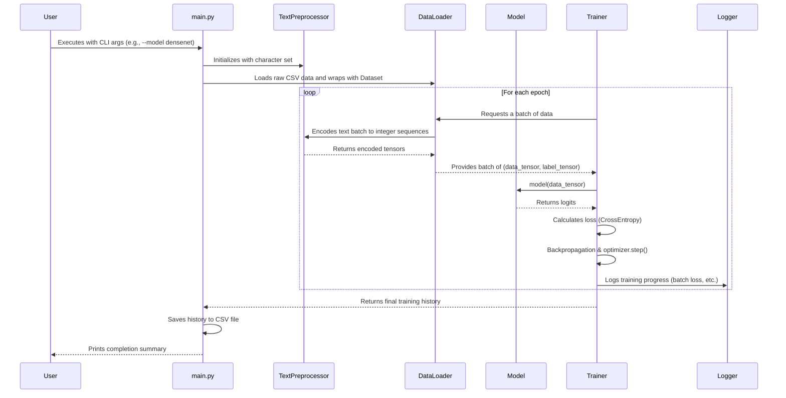
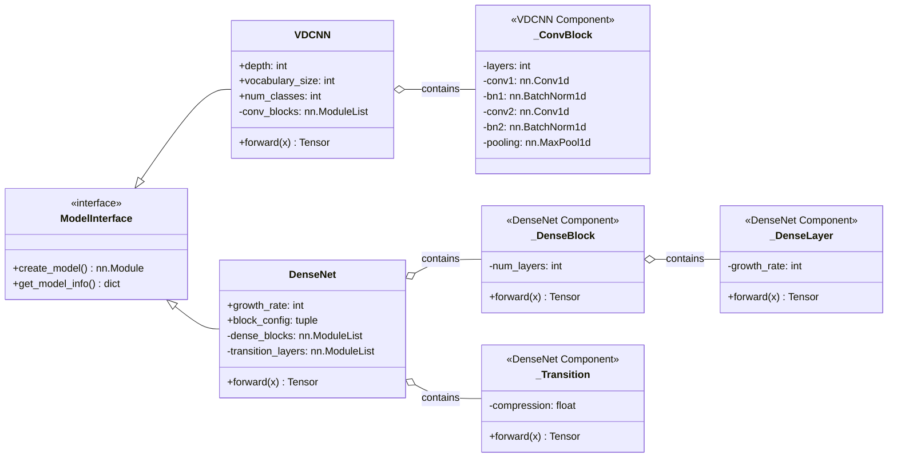
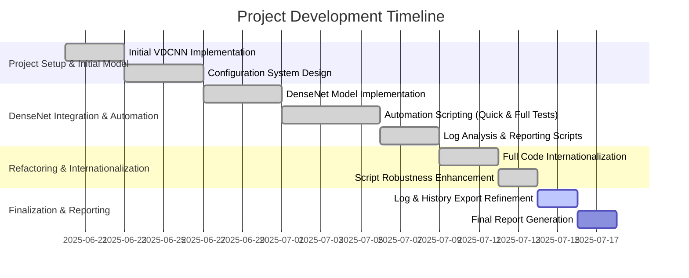

# Presentation Charts and Diagrams

This document contains all the necessary charts and diagrams for the project presentation, with titles and descriptions in English.

## 1. System Architecture Diagram

This diagram illustrates the high-level architecture of the text classification framework, showcasing the interaction between core components. It highlights the modular design and adherence to SOLID principles.

```mermaid
graph TD
    subgraph "Input Layer"
        A[CLI / User Input] --> B(main.py);
    end

    subgraph "Configuration Core"
        B --> C{ConfigManager};
        C --> D1[global_defaults.yaml];
        C --> D2[dataset.yaml];
        C --> D3[model.yaml];
        C --> D4[CLI Overrides];
    end

    subgraph "Data Pipeline"
        E[Raw CSV Data] --> F[TextPreprocessor];
        F --> G(torch.utils.data.DataLoader);
    end

    subgraph "Model Core"
        H{Model Factory} --> I1[VDCNN];
        H --> I2[DenseNet];
        C --> H;
    end

    subgraph "Training & Evaluation Engine"
        J[Trainer] --> K[Evaluator];
        G --> J;
        H --> J;
        C --> J;
    end

    subgraph "Output & Reporting"
        L[Logger] --> M[Log Files (.log)];
        J --> N[Training History (.csv)];
        K --> O[Evaluation Metrics];
        P[analyze_logs.py] --> Q[Charts & Reports (.png, .md)];
        N --> P;
        M --> P;
    end

    B --> C;
    B --> F;
    B --> H;
    B --> J;
    J --> L;
    K --> L;
```

## 2. Data Flow Diagram

This diagram describes the end-to-end data flow, from raw data ingestion to the final output of predictions and performance metrics.



## 3. Model Architecture Comparison

This diagram highlights the key architectural differences between the VDCNN and DenseNet models as implemented in this project. It contrasts VDCNN's sequential convolutional blocks with DenseNet's feature-reuse-centric design.



## 4. Project Development Timeline

This Gantt chart outlines the major milestones and development phases of the project, showcasing the progression from initial setup to the final, robust experimentation framework.

