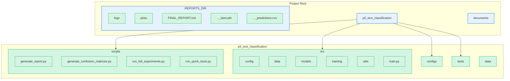
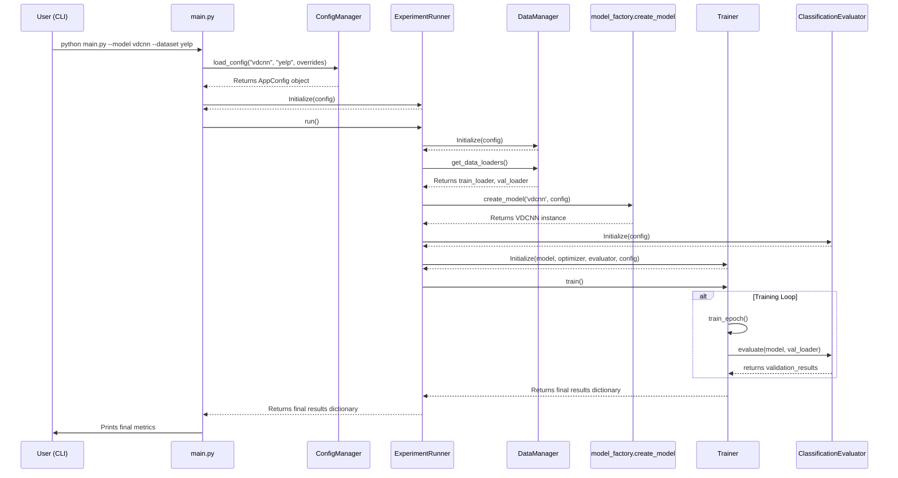
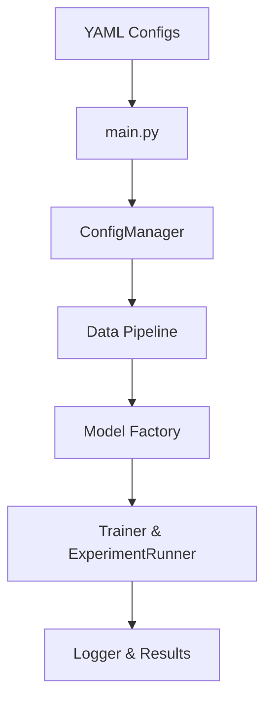
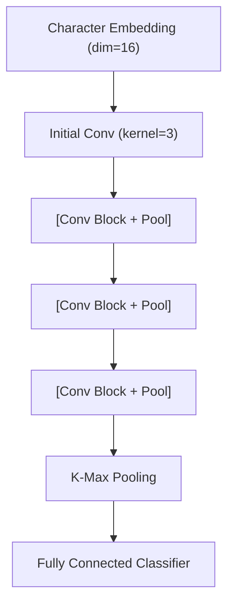
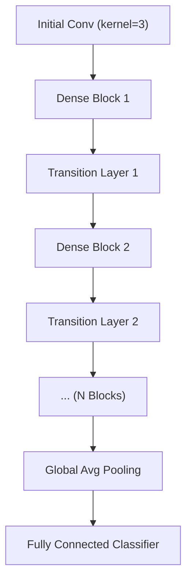
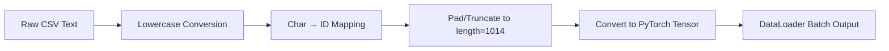

# Project Technical Documentation

## 1. Project Overview

This project implements and refactors a deep learning framework for character-level text classification. It supports multiple architectures (e.g., VDCNN, DenseNet) and is designed with a strong emphasis on software engineering best practices, including SOLID principles, a clear separation of concerns, and a robust, configuration-driven workflow. The recent refactoring has modularized the codebase, making it more scalable, maintainable, and testable.

## 2. Project Structure (Post-Refactoring)

The new structure emphasizes a clear separation of concerns, with distinct packages for configuration, data handling, models, training logic, and utilities. All experiment artifacts and final reports are consolidated under the `REPORTS` directory.



### 2.1. File and Directory Layout

- **p5_text_classification/**
  - `src/`: Core application source code.
    - `train.py`: Main training script, driven by a single configuration file.
    - `config/`: Configuration loading and management.
    - `data/`: Data loading, preprocessing, and management.
    - `models/`: Model architecture definitions (VDCNN, DenseNet).
    - `training/`: High-level training orchestration and logic.
    - `utils/`: Shared utilities like logging and constants.
  - `configs/`: YAML configuration files for datasets, models, and training experiments.
  - `data/`: Raw dataset files (Yelp, Yahoo).
  - `scripts/`: Standalone scripts for automation and analysis.
    - `generate_report.py`: **(NEW)** A flexible script to parse logs and generate all comparison plots and reports.
    - `generate_confusion_matrices.py`: **(REFACTORED)** Generates a confusion matrix for a given prediction file.
    - `run_full_experiments.py`: Helper script to run a suite of experiments (can be adapted or used for batch runs).
    - `run_quick_tests.py`: Helper script for running quick, small-scale tests.
  - `tests/`: Unit and integration tests.
- **REPORTS/**: All output artifacts from experiments are saved here.
  - `logs/`: Detailed log files for each training run.
  - `plots/`: All generated charts and graphs.
  - `FINAL_REPORT.md`: The final, comprehensive project report.
  - `*_best.pth`: Saved model weights for the best performing epochs.
  - `*_predictions.csv`: Prediction results on the test set.
- **documents/**: Project-related documentation, such as the original papers.
- `PROJECT_DOCS.md`: This file, providing technical documentation of the project.
- `README.md`: General project overview and setup instructions.
- `requirements.txt`: Python package dependencies.

## 3. Design Principles & Architecture

The project adheres to modern software engineering principles to ensure the codebase is robust, scalable, and maintainable.

### 3.1. Core Design Philosophy

-   **SOLID Principles**: The entire codebase is structured following the SOLID principles.
    -   **S (Single Responsibility Principle)**: Each class and module has a single, well-defined purpose (e.g., `DataManager` handles data, `Trainer` handles the training loop).
    -   **O (Open/Closed Principle)**: The architecture is open to extension but closed for modification. For example, adding a new model is possible without altering existing trainer or runner code, primarily through configuration and factory updates.
    -   **L (Liskov Substitution Principle)**: All components adhere to defined interfaces (though Python uses duck typing, the principle is followed in spirit), allowing different implementations (e.g., different evaluators) to be swapped without issues.
    -   **I (Interface Segregation Principle)**: Components are designed with minimal, focused interfaces.
    -   **D (Dependency Inversion Principle)**: High-level modules (like `ExperimentRunner`) depend on abstractions, not on concrete low-level implementations. Dependencies are managed via configuration and injected at runtime.
-   **SSOT (Single Source of Truth)**: All configuration, including file paths, hyperparameters, and model settings, is managed in one place: the `configs/` directory. There are no hardcoded values within the source code, which allows for easy experimentation and prevents inconsistencies.
-   **Configuration-Driven Workflow**: The application is entirely driven by YAML configuration files. This allows for defining, tracking, and reproducing experiments without changing any code.

### 3.2. Model Architecture Comparison

| Feature                | VDCNN                            | DenseNet                               |
| ---------------------- | -------------------------------- | -------------------------------------- |
| **Core Concept**       | Very deep convolutional networks | Densely connected feature reuse        |
| **Layer Range**        | 9-49 layers                      | Dynamic (depends on block config)      |
| **Feature Extraction** | Hierarchical abstraction         | Feature accumulation and reuse         |
| **Parameter Count** | 15M-50M | 8M-20M |
| **Memory Requirements** | Moderate | Higher (stores all intermediate features) |
| **Training Speed** | Faster | Moderate |
| **Convergence** | Standard | Better (smoother gradient flow) |

### 3.3. Character-Level Processing

The project uses a character-level approach for text processing, which has several advantages over traditional word-level methods.

-   **Language Agnostic**: It does not require language-specific tokenizers and can work across different languages.
-   **Robustness to OOV (Out-of-Vocabulary)**: It naturally handles misspellings, slang, and rare words without an "unknown token" problem.
-   **Fine-Grained Features**: It can capture sub-word features like prefixes and suffixes, which can be meaningful.

## 4. Core Components & Logic

### 4.1. Configuration (`src/config/`)

-   **`base_config.py`**: Defines a set of `dataclasses`, with `AppConfig` as the root. This provides a type-safe, predictable structure for all configuration parameters.
-   **`config_manager.py`**: Contains `ConfigManager`, which is responsible for loading YAML files from the `configs/` directory, performing a deep merge, and instantiating the `AppConfig` object.

#### 4.1.1. YAML Configuration Files (`configs/`)

-   **`global_defaults.yaml`**: Base configuration providing default values for all experiments, including common hyperparameters and directory paths.
-   **`datasets/`**:
    - `yahoo.yaml`: Settings specific to the Yahoo dataset (file paths, preprocessing parameters).
    - `yelp.yaml`: Settings specific to the Yelp dataset (file paths, preprocessing parameters).
-   **`models/`**:
    - `densenet.yaml`: Hyperparameters for the DenseNet model (growth rate, block configuration, dropout rates).
    - `vdcnn.yaml`: Hyperparameters for the VDCNN model (depth, embedding dimension, convolutional block settings).
-   **`training/`**:
    - `yahoo_densenet.yaml`: Training parameters for DenseNet on the Yahoo dataset (batch size, epochs, learning rate).
    - `yahoo_vdcnn.yaml`: Training parameters for VDCNN on the Yahoo dataset (batch size, epochs, learning rate).
    - `yelp_densenet.yaml`: Training parameters for DenseNet on the Yelp dataset (batch size, epochs, learning rate).
    - `yelp_vdcnn.yaml`: Training parameters for VDCNN on the Yelp dataset (batch size, epochs, learning rate).

### 4.2. Utilities (`src/utils/`)

-   **`constants.py`**: Establishes a Single Source of Truth (SSOT) for all important directory paths (`PROJECT_ROOT`, `CONFIG_DIR`, `DATA_DIR`, `REPORTS_DIR`, `LOGS_DIR`). It dynamically finds the project root to ensure robustness.
-   **`logger.py`**: Provides a simple `setup_logger(config)` function that creates a standardized, timestamped logger which writes to both the console and a file in the `reports/logs` directory.

### 4.3. Data Handling (`src/data/`)

-   **`preprocessor.py`**: A self-contained `TextPreprocessor` class for character-level encoding and padding.
-   **`data_manager.py`**: Encapsulates all data loading logic. `DataManager` takes the `AppConfig`, reads CSV files from paths defined in `constants.py`, uses the `TextPreprocessor`, and creates and returns `DataLoader` instances for training and validation.

### 4.4. Models (`src/models/`)

-   **`vdcnn_model.py` / `densenet.py`**: Model definitions. They are now clean classes that accept parameters like `num_classes` and `vocab_size` directly in their constructors.
-   **`factory.py`**: Contains a simple `create_model(model_name, ...)` function that replaces the over-engineered factory class. It uses a simple `if/elif` to return the correct model instance.

### 4.5. Training (`src/training/`)

-   **`trainer.py`**: The `Trainer` class now strictly adheres to the Single Responsibility Principle. It only handles the core training loop for a given number of epochs. It no longer contains any validation or evaluation logic.
-   **`evaluator.py`**: The new `ClassificationEvaluator` class encapsulates all evaluation logic. Its `evaluate` method takes a model and a data loader, computes metrics (loss, accuracy), and returns a results dictionary.
-   **`experiment_runner.py`**: The high-level orchestrator. The `ExperimentRunner` class (and its `run` method) ties everything together:
    1.  Initializes `DataManager` to get data loaders.
    2.  Calls the model `factory` to get a model instance.
    3.  Initializes the `ClassificationEvaluator`.
    4.  Initializes the `Trainer`, providing it with the model, optimizer, and the evaluator instance.
    5.  Calls `trainer.train()` to run the full training and validation cycle.
    6.  Returns a dictionary of final results.

### 4.6. Entry Point (`main.py`)

-   A thin script that only handles command-line argument parsing. It initializes the `ConfigManager`, calls `run_experiment`, and prints the final results.

## 4.7. Experiment Suite Scripts (`scripts/`)

-   **`run_quick_tests.py`**: Executes small-scale quick tests for all model-dataset combinations, validating core functionality and generating a summary report.
-   **`run_full_experiments.py`**: Executes full-scale training experiments across model-dataset combinations, supports CLI overrides for epochs, batch size, learning rate, and max samples, includes timeout handling, intermediate result saving, and generates comprehensive Markdown reports.

## 5. Annotated Configuration Example

To provide a clear understanding of the configuration-driven workflow, here is an annotated example of a complete training configuration for running VDCNN on the Yahoo dataset. The final configuration is a result of merging `global_defaults.yaml`, `datasets/yahoo.yaml`, `models/vdcnn.yaml`, and `training/yahoo_vdcnn.yaml`.

```yaml
# === Generated from global_defaults.yaml ===
project_name: "p5_text_classification"
timestamp: "{timestamp}" # Dynamically inserted at runtime

# === Generated from datasets/yahoo.yaml ===
dataset:
  name: "yahoo"
  path: "p5_text_classification/data/yahoo"
  train_file: "train.csv"
  test_file: "test.csv"
  num_classes: 10

# === Generated from models/vdcnn.yaml ===
model:
  name: "vdcnn"
  # Parameters specific to the VDCNN architecture
  params:
    depth: 9 # Depth of the network (e.g., 9, 17, 29, 49)
    vocab_size: 71 # Size of the character vocabulary (69 chars + PAD + UNK)
    embedding_dim: 16 # Character embedding dimension, as per the paper

# === Generated from training/yahoo_vdcnn.yaml ===
training:
  # Core training settings
  epochs: 15
  batch_size: 128
  
  # Optimizer settings (following the paper)
  optimizer:
    type: "SGD"
    lr: 0.01
    momentum: 0.9
    weight_decay: 0.0001

  # Learning rate scheduler settings
  scheduler:
    type: "MultiStepLR"
    # Milestones are defined as a ratio of total epochs
    milestones_ratio: [0.5, 0.75] # Halve LR at 50% and 75% of total epochs
    gamma: 0.1 # The factor to reduce the LR by

  # Hardware and performance settings
  num_workers: 4 # Number of threads for data loading
  
  # Optional: limit samples for quick tests (null by default)
  max_samples: null
```

## 6. Interaction and Data Flow

### 6.1. System Startup Flow

The new flow is much cleaner and follows a more logical chain of command, with `main.py` delegating all heavy lifting to the `experiment_runner`.



## 7. Static Architecture Diagrams

### 7.1. Overall Project Architecture


### 7.2. VDCNN Architecture Diagram


### 7.3. DenseNet-BC Architecture Diagram


### 7.4. Data Pipeline Flowchart


## 8. Runtime-Generated Plots
During model training and evaluation, use the `plot_results.py` utility to generate the following plots from the training history CSV files and save them under the `reports/` directory, or use the consolidated analysis script:

- **Training & Validation Loss Curves:** `reports/{model}_{dataset}_loss.png` (one plot per experiment)
- **Training & Validation Accuracy Curves:** `reports/{model}_{dataset}_accuracy.png` (one plot per experiment)
- **Final Performance Comparison Bar Chart:** `reports/performance_comparison.png` (aggregated across all experiments)
- **Confusion Matrices:** `reports/confusion_matrix_{model}_{dataset}.png` (for multi-class tasks, e.g., Yahoo dataset)

Run the following PowerShell commands to produce the plots:

```powershell
# Individual training curves
Get-ChildItem -Path reports\training_history\*.csv | ForEach-Object {
    python src/utils/plot_results.py --results_file $_.FullName; Write-Host ''
}

# Consolidated analysis and report generation
python scripts/analyze_logs.py; Write-Host ''
```

Ensure all generated images are included in your presentation to illustrate training progress and performance.

## 9. Full Experiment Results

| Experiment                  | Duration (h) | Final Accuracy | Model Parameters |
|-----------------------------|--------------|----------------|------------------|
| DENSENET on Yahoo Answers   | 0.66         | 62.71%         | 64,482           |
| DENSENET on Yelp Reviews    | 0.30         | 90.44%         | 63,754           |
| VDCNN on Yahoo Answers      | 1.21         | 71.83%         | 14,188,474       |
| VDCNN on Yelp Reviews       | 0.51         | 94.73%         | 14,172,082       |
| **Total Duration**          | **2.71**     |                |                  |

## 10. Outputs and Artifacts

When experiments are run, several artifacts are generated and stored in the `REPORTS/` directory. This ensures that all results are saved, traceable, and available for later analysis.

### 10.1. Directory Structure of Reports

```
REPORTS/
├── logs/                     # Directory for detailed, timestamped log files
│   ├── densenet/
│   │   └── densenet_yahoo_20250705_153601.log
│   └── vdcnn/
│       └── vdcnn_yelp_20250705_132311.log
├── plots/                    # Directory for generated plots
│   ├── densenet_yahoo_accuracy.png
│   └── vdcnn_yelp_loss.png
├── training_history/         # Directory for raw training data (loss/accuracy per epoch)
│   └── densenet_yahoo_20250705_081048.csv
├── densenet_yahoo_best.pth   # Best model checkpoint (saved during training)
└── densenet_yahoo_predictions.csv # Predictions from the test set
```

### 10.2. Artifact Descriptions

-   **Log Files (`REPORTS/logs/**/*.log`)**:
    -   **Purpose**: To provide a detailed, human-readable record of the entire training and evaluation process.
    -   **Content**: Includes configuration parameters, data loading progress, model architecture summary, per-epoch training loss, validation accuracy, and final results. This is the primary file for debugging and manual review.

-   **Model Checkpoints (`REPORTS/*.pth`)**:
    -   **Purpose**: To save the state dictionary of the model that achieved the highest validation accuracy during training.
    -   **Usage**: These files can be loaded later for inference, further training, or analysis without needing to retrain the model.

-   **Prediction Files (`REPORTS/*_predictions.csv`)**:
    -   **Purpose**: To store the model's predictions on the test set.
    -   **Content**: A CSV file with two columns: `true_label` and `predicted_label`, allowing for detailed error analysis (e.g., generating a confusion matrix).

-   **Training History (`REPORTS/training_history/*.csv`)**:
    -   **Purpose**: To provide a machine-readable log of key performance metrics for each epoch.
    -   **Content**: A CSV file with columns like `epoch`, `train_loss`, `val_loss`, `train_acc`, and `val_acc`. This data is used by analysis scripts to generate performance graphs.

-   **Plots (`REPORTS/plots/*.png`)**:
    -   **Purpose**: To visualize the training progress and final results.
    -   **Content**: Includes loss curves, accuracy curves, and comparison bar charts generated by the analysis scripts.

## 7. Hyperparameter Rationale

The selection of hyperparameters is critical for the successful reproduction of academic results. The parameters in the configuration files (`configs/`) are chosen based on a clear hierarchy: **direct paper specifications**, followed by **common industry practices**. This section justifies the default values for our key hyperparameters.

### 7.1. VDCNN (`models/vdcnn.yaml`, `training/*_vdcnn.yaml`)

The settings for VDCNN are chosen to align as closely as possible with the original paper, *"Very Deep Convolutional Networks for Text Classification"* by Conneau et al.

-   **`embedding_dim: 16`**
    -   **Rationale**: Directly follows the paper's specification. The authors state, "The characters are first embedded into a 16-dimensional space." This low-dimensional embedding is a key feature of the character-level approach.

-   **`depth: 9` (as default)**
    -   **Rationale**: The paper experiments with depths of 9, 17, 29, and 49. We selected 9 as the default because it is the fastest to train while still being a valid, paper-specified architecture, making it ideal for initial experiments. Deeper models can be run by overriding this setting.

-   **`optimizer: SGD` with `lr: 0.01`, `momentum: 0.9`**
    -   **Rationale**: This is explicitly specified in the "Training" section of the paper. They use a standard Stochastic Gradient Descent (SGD) optimizer with momentum. The initial learning rate of 0.01 is the starting point for their learning rate schedule.

-   **`scheduler: MultiStepLR` with `milestones_ratio: [0.5, 0.75]`**
    -   **Rationale**: The paper states, "we use a learning rate of 0.01 and decrease it by a factor of 10 twice during training." Our `MultiStepLR` scheduler with a `gamma` of 0.1 (a factor of 10 decrease) and milestones at 50% and 75% of the total epochs is a programmatic implementation of this exact strategy.

-   **`batch_size: 128`**
    -   **Rationale**: Directly follows the paper's specification. They mention using a batch size of 128 for all of their experiments.

### 7.2. DenseNet (`models/densenet.yaml`, `training/*_densenet.yaml`)

The parameters for DenseNet are based on the original paper, *"Densely Connected Convolutional Networks"* by Huang et al., as well as common adaptations for text classification.

-   **`growth_rate: 12`**
    -   **Rationale**: The growth rate (k) is a fundamental parameter in DenseNet. The paper experiments with k=12
